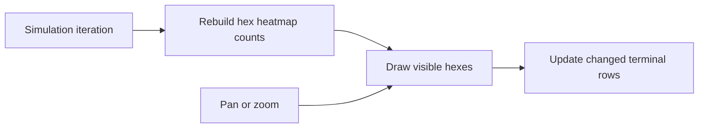

# How the map is drawn

PengSim's world and cells are **hexagonal**. The main display and minimap are **rectangular windows** looking at that world.

## Zoom and colors

At **L0**, each symbol is one map cell. Zooming out groups nearby cells into larger **hexagonal buckets**. Their color shows penguin density: blue is low, purple is medium, and red is high. Zooming in reveals smaller buckets again.

The minimap stays fixed. **Yellow hexes** outline the main view; **teal dots** mark the world boundary.

## Rendering

1. `HexHeatmap.Rebuild(environment)` refreshes counts after a simulation iteration. The current static demo calls it once at startup.
2. `FrameLayout` calculates panel sizes; `FrameRenderer` draws only the visible hexes into a terminal buffer.
3. `TerminalPresenter` writes changed terminal rows in one update.

Panning and zooming reuse the same heatmap snapshot. Keyboard input is handled by `EnvironmentDrawer`.
