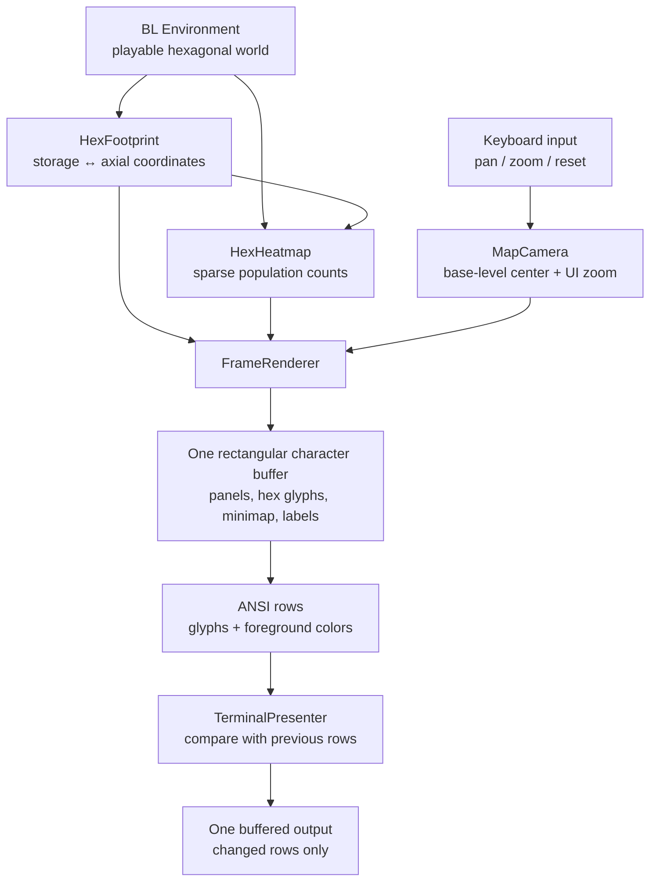
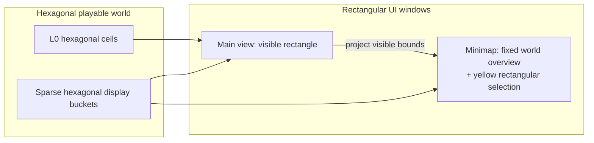
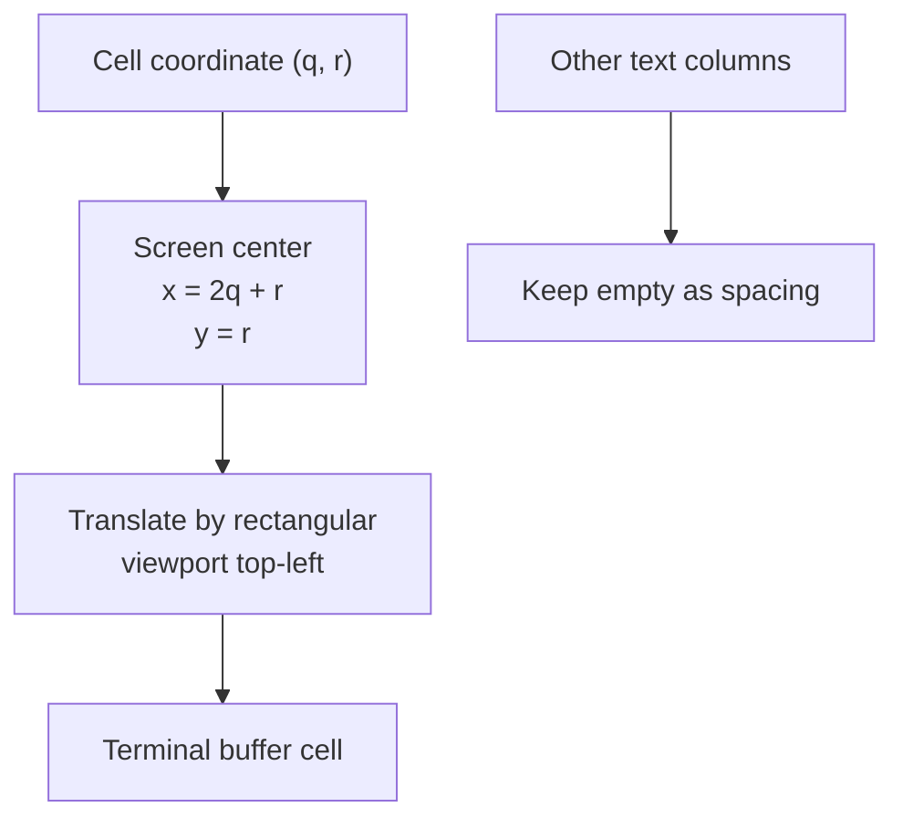
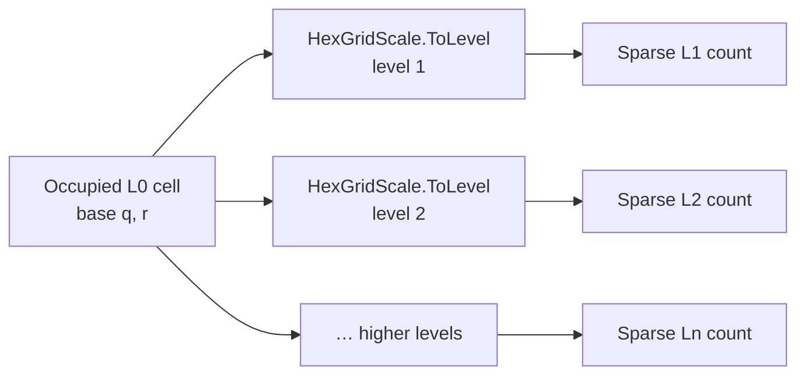
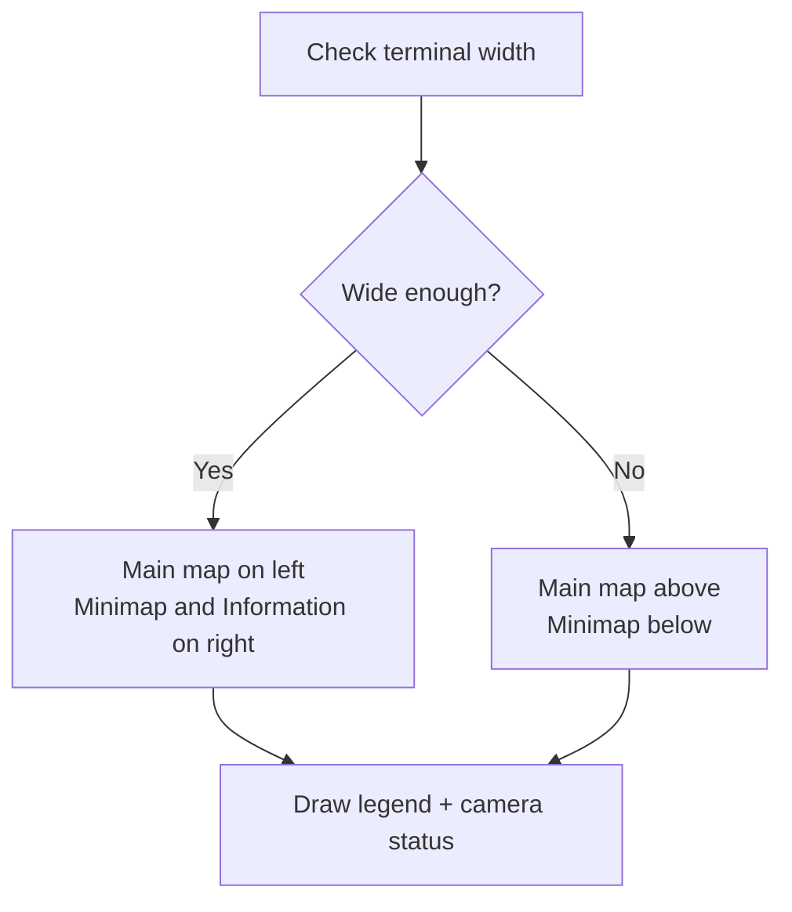
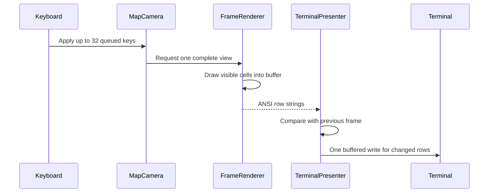

# Rendering the hexagonal environment

This document describes the **UI renderer**, not the simulation rules. The playable environment, its cells, and movement rules remain hexagonal. Only the **visible windows** in the main display and minimap are rectangular.

The interactive UI uses one rendering path:

- `EnvironmentDrawer` handles keyboard input and owns the camera.
- `HexHeatmap` indexes population counts at display zoom levels.
- `FrameRenderer` builds a complete terminal-character buffer.
- `TerminalPresenter` sends only changed rows in one buffered write.

No Spectre.Console layout, widget tree, or per-hex terminal update is involved.

## 1. From simulation to terminal



The renderer treats the current `Environment` as the source of truth at **L0**. For zoomed-out levels, it looks up a count in the sparse `HexHeatmap` index. A full-frame computation touches only characters within the terminal window.

## 2. The world is hexagonal; the camera is rectangular

The model represents a centered axial hexagon, and `HexFootprint` maps it into the storage grid. A camera can look at empty cells in the rectangular storage area outside the playable world; those locations have no penguins and do not alter the BL.



Conceptually, a narrow map view can include both playable hexes and empty corners:

```text
      rectangular main panel
    ┌─────────────────────────┐
    │  · · ·  ⬡ ⬡  · · · · · ·   │
    │  · ·  ⬡ ⬢ ⬢ ⬡  · · · ·   │
    │  ·  ⬡ ⬢ ⬢ ⬢ ⬢ ⬡  · ·   │
    │  · ·  ⬡ ⬢ ⬢ ⬡  · · · ·   │
    │  · · ·  ⬡ ⬡  · · · · · ·   │
    └─────────────────────────┘
    ⬡ = empty playable hex
    ⬢ = occupied / density hex
    · = outside-world location or edge
```

The drawing is illustrative, not an exact snapshot of the terminal grid.

## 3. Hex coordinates and screen coordinates

Each cell has axial coordinates `(q, r)`. The renderer projects their **centers** to monospaced character positions:

```text
screenX = 2*q + r
screenY = r

q = (screenX - screenY) / 2
r = screenY
```

Only positions for which `screenX - screenY` is even are cell centers. Odd positions stay blank as spacers, making alternate rows appear staggered.



The camera is centered in base-level axial coordinates. When the view zooms out, `HexGridScale.ToLevel` places base hexes into coarser **hexagonal** buckets. It uses cube-coordinate rounding with `s = -q - r`, maintaining `q + r + s = 0` after rounding; the scale changes by a factor of two per UI zoom level **without rotating the map**. This UI index is separate from the original seven-child transform on `HexCell`.

## 4. Zoom levels and population data

`HexHeatmap` initially scans the playable base cells once. It stores counts **only for occupied coarse hex buckets**, with one dictionary per display zoom level.



A visible coarser hex uses a dictionary count lookup; a missing entry means zero penguins. At L0, occupancy comes directly from the current environment cell.

For a future **live simulation**, a move from A to B needs to update the sparse index after the underlying model changes:

```text
heatmap.ChangePopulation(A, -1);
heatmap.ChangePopulation(B, +1);
```

These calls are an **integration requirement**, not an automatic subscription to BL mutations. A move updates one bucket at each zoom level, so the index update cost is proportional to the number of zoom levels rather than the world area.

## 5. Rectangular layout and minimap selection

The outer frame reserves space for the simulation title, iteration, legend, position, and controls. The main/minimap windows use two arrangements:



A wide layout looks approximately like this:

```text
╭──────────────────────────────────────────────────────╮
│ Simulation information                               │
│ ╭──────────────────────╮  ╭───────────────────────╮ │
│ │ Main map             │  │ Minimap               │ │
│ │ rectangle            │  │ fixed overview        │ │
│ │                      │  │ yellow viewport edge  │ │
│ │                      │  ╰───────────────────────╯ │
│ │                      │  ╭───────────────────────╮ │
│ │                      │  │ Camera information    │ │
│ ╰──────────────────────╯  ╰───────────────────────╯ │
│ Legend; current zoom and position                    │
│ Keyboard help                                        │
╰──────────────────────────────────────────────────────╯
```

`ViewportProjection.Project` maps the **main rectangle** to minimap coordinates. The minimap's world position stays fixed when navigating. It computes the projected center and projected half-width/half-height separately, so the selected rectangle does not expand, shrink, or twist while panning at the same zoom level. Its sides are drawn with **yellow foreground hex glyphs only**; the underlying heatmap remains unchanged. The camera center has a separate marker.

Green/teal dots mark **the world border**, not the camera window. The outside ring is detected at hex distance `world.Radius + 1`.

## 6. Colors and terminal output

`HeatmapPalette` returns a `MapPaint` containing a glyph and a packed 24-bit foreground color (`0xRRGGBB`). The color bands are fixed:

| Population in display hex | Glyph | Meaning |
|---|---|---|
| 0 | `⬡` | Empty playable hex |
| 1–2 | `⬢` | Sparse population, blue |
| 3–15 | `⬢` | Increasing density, purple/pink |
| 16–127 | `⬢` | Higher density, pink/red |
| 128+ | `⬢` | Highest density, red |

The exact ten thresholds and RGB colors are defined in `HeatmapPalette.cs`; the table groups them for readability. `·` represents non-playable space, and teal dots identify the world-edge ring. Yellow hexes identify the minimap selection.

`FrameRenderer` writes glyphs into a flat row-major array. Once complete, it produces ANSI-colored strings. `AnsiCodes` names the terminal protocol sequences instead of embedding mysterious escapes among the hex calculations:

| Helper | Terminal meaning |
|---|---|
| `AppendForegroundRgb` | `ESC [ 38;2;R;G;B m`: set 24-bit foreground |
| `ResetStyle` | `ESC [ 0 m`: reset styles |
| `AppendMoveToRowStart` | `ESC [ row;1 H`: move cursor |
| `EraseCurrentLine` | `ESC [ 2 K`: clear old row |
| `ClearScreen` | `ESC [ 2 J`: clear on resize/start |
| `HideCursor` / `ShowCursor` | Hide during painting, restore on exit |

`ESC` is the ASCII escape character (U+001B). These sequences are standard VT/ANSI terminal controls, not application-specific rendering data.

## 7. Atomic redraw and performance



**No updates occur per hexagon.** The complete new frame is assembled before the terminal is touched. `TerminalPresenter` compares ANSI rows (including foreground color) with the preceding frame, skips unchanged rows, and clears/redraws the others using cursor positioning. On terminal resize it invalidates the old frame.

The previous local profiling result for this architecture reported **0.78 ms average frame preparation** and **2.58 ms average output** for 28 navigation frames; it is a measured example, not a guaranteed speed on every machine or terminal.

Run locally with profiling enabled:

```bash
PENGSIM_PROFILE=1 dotnet run --project src/PengSim.UI
# Navigate/zoom, then press Q.
cat pengsim-profile.log
```

The application saves the report after rendering stops. Set `PENGSIM_PROFILE_PATH` to choose another report path.

## 8. Where to make changes

| Change | File |
|---|---|
| Camera movement, zoom and input | `Rendering/EnvironmentDrawer.cs`, `Map/MapCamera.cs` |
| Panel positions, margins, labels and glyph placement | `Rendering/FrameRenderer.cs` |
| Heatmap thresholds and colors | `Rendering/HeatmapPalette.cs` |
| Terminal ANSI formatting and changed-row writes | `Rendering/TerminalPresenter.cs` |
| Rectangular minimap camera projection | `Map/ViewportProjection.cs` |
| Display-level hex coordinate mapping | `Map/HexGridScale.cs` |
| Sparse population lookup and incremental updates | `Map/HexHeatmap.cs` |

The rendering code must not change the underlying playable world or the business-logic model.
