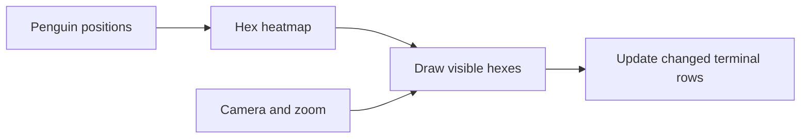

# How the map is drawn

PengSim's world and individual cells are **hexagonal**. The main display and minimap are simply **rectangular windows** looking at that world.

## Zoom and colors

At **L0**, one symbol represents one map cell. Zooming out groups nearby cells into larger **hexagonal buckets**. The color of each bucket shows its penguin count: blue is low density, purple is medium, and red is high. Zooming in reveals smaller buckets again.

The minimap stays fixed. **Yellow hexes** outline the part visible in the main display; **teal dots** mark the world boundary. The viewing windows are rectangular, but the world never changes shape.

## Rendering

1. `HexHeatmap` keeps penguin counts for zoomed-out hexes.
2. `FrameRenderer` draws the visible map, minimap, and labels into one terminal-sized buffer.
3. `TerminalPresenter` updates only rows that changed, in one write.

Keyboard input and camera movement are handled by `EnvironmentDrawer`. The UI draws directly to the terminal without a Spectre.Console layout engine.
